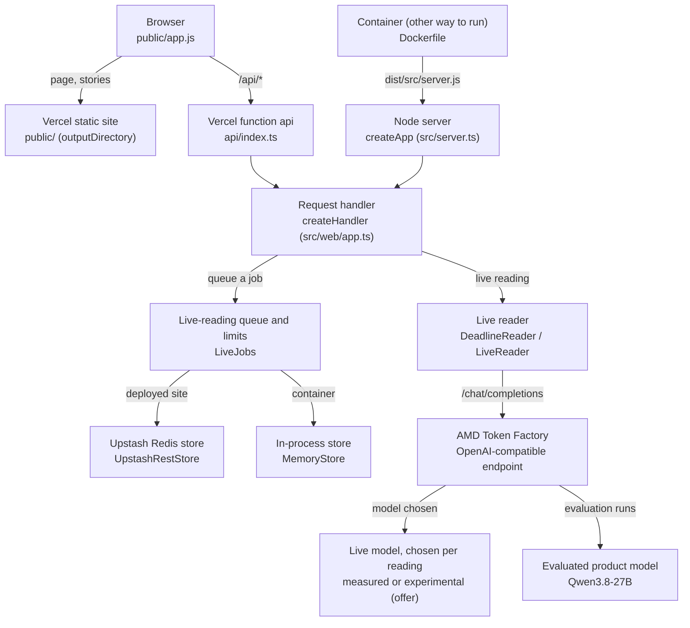
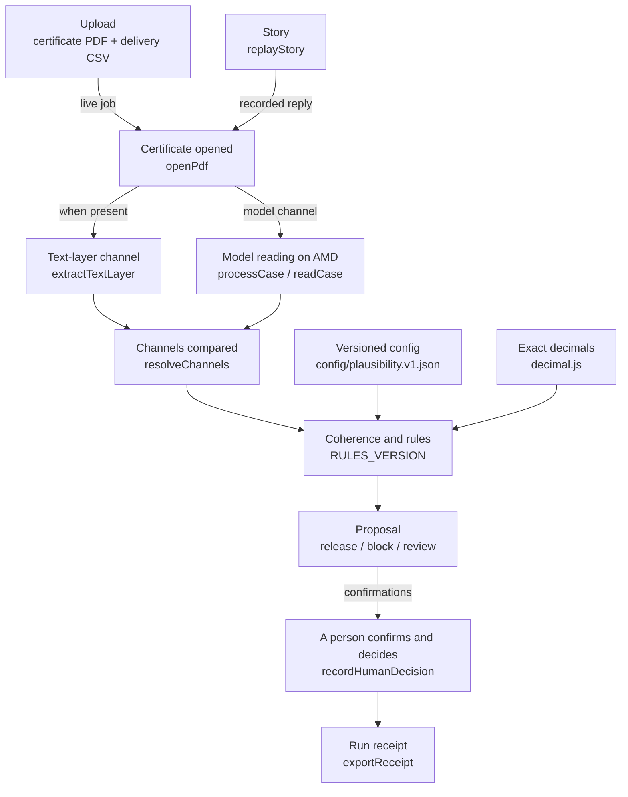

# CertGate

**CertGate checks a steel mill certificate (an inspection certificate of the EN 10204 3.1 kind) against the purchase specification, for the goods-in or Quality technician who must release or block the batch.**
How it works: a model on AMD Token Factory reads the certificate (Qwen3.8-27B, the evaluated model, for every figure below; live reading also offers other measured and experimental models), deterministic versioned rules propose release, block or review, and a person decides; CertGate never releases material on its own.
Results on the 27 evaluated fictitious certificates (2 Qwen3.8-27B runs): false conforming **0/18** in both runs; proposals equal to the expected proposal **27/27** (implementer run) and **26/27** (auditor's independent run); fields read correctly **591/594** in both runs.
Utility, of the 9 cases whose expected proposal is release: proposed release **9/9** (implementer run) and **8/9** (auditor's run); sent to review without need **0/9** (implementer run) and **1/9** (auditor's run, cg-004: the model read the printed CEV with a decimal comma, "0,39", the text layer read 0.39, and the channel check disagreed).
[Deployed site](https://certgate-wheat.vercel.app) · [judge mode](https://certgate-wheat.vercel.app/#/judge) · [screenshots](#screenshots)

> **All data in this repository is fictitious.** Siderúrgica Valdemora S.A. (the mill), Talleres Ribera Norte
> S.L. (the buyer), the grade TRN-355 and the purchase specification ESP-014 are invented for the demo. The limits
> in ESP-014 belong to that fictitious company and are **not** the limits of any real standard. Only these
> synthetic certificates are ever sent to the model endpoint.

Companion documents: [METRICS.md](METRICS.md) (evaluation, generated) · [DEPLOY.md](DEPLOY.md) (Vercel, for the
operator) · [CLAIMS.md](CLAIMS.md) (every capability sentence and its proof) ·
[EVIDENCE-INDEX.md](EVIDENCE-INDEX.md) (where the evidence is).

## Try it

- **Site:** https://certgate-wheat.vercel.app
- **Judge mode** (`#/judge`): three recorded real readings by the model, with their receipts. It works at any time,
  makes no model call and has no limit. Each run is labelled "recorded real reading … not live".
- **Live reading:** a new reading of a certificate on AMD Token Factory. It needs the access code given to the
  judges; the code is never written in this repository.
- **Model choice:** the live screen lists every model AMD Token Factory lists now, with the time of that check.
  You can choose only a measured model (Qwen3.8-27B, Gemma-4-31B-IT) or an experimental model that passed a probe
  in this stage, and only while the endpoint lists it. An experimental model is labelled "not evaluated", needs an
  explicit acknowledgement, and no figure of CertGate applies to it.
- **Sample certificates:** the live screen offers three fictitious certificates (cg-004, cg-005, cg-010) and their
  delivery notes, to download and upload back.
- **The original certificate:** every case shows "View the original certificate", the page image of the document
  the reading came from, beside the values. For an upload that is not one of the samples, the page says that the
  original is your own file.

### The certificates and their previews

GitHub cannot show the scanned PDFs, so each certificate the site shows has a PNG preview next to it. The previews
are made by [tools/previews.mjs](tools/previews.mjs) from the committed PDFs: for a scan, the PDF's own page image;
for a digital certificate, page 1 rendered by the pinned pdf.js. Running the script again gives the same bytes.

| Case | PDF | Preview | Preview SHA-256 |
|---|---|---|---|
| cg-001 · story, conforming (digital) | [certificate.pdf](data/cases/cg-001/certificate.pdf) | [cg-001.png](data/previews/cg-001.png) | `686b0e2f4687d9557220cc8bef65f84423ee656a1d3cc2687efd5f515edd116f` |
| cg-002 · story, out of spec (scan) | [certificate.pdf](data/cases/cg-002/certificate.pdf) | [cg-002.png](data/previews/cg-002.png) | `b4eaf0d17d76a5f764b9cdebbb5f7f4166cc1e06d4b854f9bb297a6c9300b5fe` |
| cg-003 · story, the ambiguous scan (scan) | [certificate.pdf](data/cases/cg-003/certificate.pdf) | [cg-003.png](data/previews/cg-003.png) | `9fb6e411349eb8c1b57833b19d09b361e40de299544244ac92a9b7d4cf05b174` |
| cg-004 · sample (digital) | [certificate.pdf](data/cases/cg-004/certificate.pdf) | [cg-004.png](data/previews/cg-004.png) | `b850c1e334d440e6f619a76bb0e5e5af48e19480c92ab37858b0b7992ca8c413` |
| cg-005 · sample (digital) | [certificate.pdf](data/cases/cg-005/certificate.pdf) | [cg-005.png](data/previews/cg-005.png) | `fc1c257336227937d7a4bd5c3908954aa1d424fdbb4dbbd360d6354fb699d51a` |
| cg-010 · sample (digital) | [certificate.pdf](data/cases/cg-010/certificate.pdf) | [cg-010.png](data/previews/cg-010.png) | `74d3335d9b32fbfc6c30031dde67f681bef1e99bc9982db4802f7e49224cbb8c` |

## What runs on AMD, and how it is shown

- **Endpoint:** AMD Token Factory, the AMD compute of the event (OpenAI-compatible; host `developer.amd.com.cn`).
- **Model:** requested as `Qwen3.8-27B`; every reply reports it as `self-dploy/Qwen3.8-27B`. Its publisher is the
  Qwen Team, and its licence, as published by the publisher, is apache-2.0
  (https://huggingface.co/Qwen/Qwen3.8-27B, retrieved 2026-10-13; see [docs/sources/model.md](docs/sources/model.md)).
- **What the model does:** it reads the page images of a certificate into the CertGate reading contract: value,
  unit, status, and the location where it says it found the value. Requests use temperature 0 and a frozen
  instruction (SHA-256 `32fad2f9…`).
- **What the model never does:** it never decides and never explains. The text-layer comparison, the coherence
  checks, the rules and the proposal run in the CertGate backend without any model, and a person decides. The
  model's reasoning text is never used or stored.
- **How it is shown:**
  - The "Runs on AMD" panel (`#/amd`) shows only what the endpoint reports: the model list, the key's rate limit
    and daily spend, and the latency, tokens and cost of the last reading.
  - Every receipt of a real reading (live or recorded) carries a copy of those values from reading time, plus the
    endpoint reply's id, created time, model and usage.
  - The endpoint does not expose the GPU model, the ROCm version or the serving-stack version. With the endpoint
    on, the panel says "not exposed by the endpoint" for them; with it off, they show "unknown", like the other
    endpoint values (the model list shows "none").
    Nothing else claims them.
- **Cost:** the cost shown is the cost reported by the endpoint; Token Factory credits are free and have no
  monetary value.

### Choosing the model for a live reading

Token Factory's model list changes without notice: Gemma-4-31B-IT was listed on 2026-10-13 and absent on
2026-10-15. So the live screen shows the list as the endpoint gives it now, in three groups:

- **Measured:** Qwen3.8-27B and Gemma-4-31B-IT, the only models with an evaluation run in [METRICS.md](METRICS.md).
  Each is selectable only while the endpoint lists it, and names its METRICS.md section and run directory. The
  default is `MODEL_ID` when it is listed, otherwise the first listed measured model; it is never an experimental
  model.
- **Not evaluated · experimental:** models that, in one real probe on 2026-10-15, accepted CertGate's request
  (the page image of the scan cg-016 and the frozen prompt) and returned a reply that passed the response schema,
  named the requested model and finished within 210 s. Four passed: DeepSeek-V4.1-Flash, DeepSeek-V4-Flash-Vision-Exp,
  MiMo-V2.6-Flash and Qwen3.8-Flash-Next ([probe evidence](evidence/runs/certgate-001/stage-8/probes/BATCH.md)).
  The probe does not judge the values read. Choosing one needs the acknowledgement "this model is not evaluated;
  no figure of CertGate applies to it", and its reading is labelled "not evaluated" next to the proposal and in its
  receipt (`evaluated: false`, with the probe evidence path).
- **Listed, not offered:** every other id the endpoint lists, shown disabled with its reason: "no image probe",
  "probe failed", "not a chat model" or "not enabled on this site".

The server checks the choice again before anything is counted: a model outside the offer, an experimental model
without the acknowledgement, or a model the endpoint does not list now is refused before any model call and
without spending the hourly limit. The reply must name the requested model (equal ignoring case, or with one
provider prefix such as `self-dploy/`); a reading never falls back to another model or to a stored result. Every
live receipt and its endpoint snapshot record the model requested and the model as reported. The rules, the
two-channel check, the review triggers and the person's decision are the same for every model. `LIVE_MODELS`
(optional) narrows the choice; without it only `MODEL_ID` is selectable.

## Evaluation (real model)

Two independent real runs read the same 27 fictitious certificates (cg-004 … cg-030). cg-001 … cg-003 were used
to tune the prompt and are excluded. Every figure comes from the committed run artifacts. The full tables, the
reporting rules (FC-broad and FC-strict, rule abstention versus failure, confident-on-illegible, aggregates over
processed cases, usage reconciliation) and the per-case comparison of the two runs are in [METRICS.md](METRICS.md),
which is generated from those artifacts.

| | Implementer run | Auditor's independent run |
|---|---|---|
| Artifacts | [evaluation/runs/real-candidate-dd557fd/](evaluation/runs/real-candidate-dd557fd/REPORT.md) | [stage-3/auditor/candidate-3/real-run/eval-retry1/](evidence/runs/certgate-001/stage-3/auditor/candidate-3/real-run/eval-retry1/) |
| Candidate · time (UTC) | `dd557fd` · 2026-10-13 17:28–17:49 | `a892f771` · 2026-10-13 19:13–19:31 |
| **False conforming** (released when the expected proposal was not release) | **0 of 18** (strict, expected block: 0 of 6) | **0 of 18** (strict: 0 of 6) |
| Non-conformities caught | 6 of 6, all proposed block | 6 of 6, all proposed block |
| Proposal as expected | 27 of 27 | 26 of 27 (cg-004: review, expected release) |
| Failures · retries | 0 of 27 · 0 | 0 of 27 · 0 |
| Field readings correct | 591 of 594 | 591 of 594 |
| Seconds per certificate, Qwen3.8-27B | mean 89.6, median 80.6 (N 27) | mean 77.1, median 76.9 (N 27) |
| Cost per certificate | mean 0.00020529 | mean 0.00020863 |

- Costs are the cost reported by the endpoint; Token Factory credits are free and have no monetary value.
- The reading path, the prompt and the rules are identical by diff in both candidates and in the accepted
  candidate `5c904693`.
- The landing page shows the figures of the implementer run and names that run. They come from
  `public/figures.json`, which is generated from the artifacts and never written by hand.

## Comparison with Gemma-4-31B-IT

CertGate reads with Qwen3.8-27B. As a comparison, Gemma-4-31B-IT read the same 27 fictitious certificates
(cg-004 … cg-030) through the same AMD Token Factory endpoint, with the same frozen prompt, the same request (only
the model id differs) and the same rules. Every reply reported the model as `self-dploy/Gemma-4-31B-IT`. Its
publisher is Google (the model card names the authors as Google DeepMind), and its licence, as published by the
publisher, is apache-2.0, with a link to the Gemma 4 licence terms (https://huggingface.co/google/gemma-4-31b-it,
retrieved 2026-10-14; see [docs/sources/gemma.md](docs/sources/gemma.md)). The figures come from the committed run
artifacts; [METRICS.md](METRICS.md) shows them next to both Qwen runs, with every per-case difference.

| | Gemma-4-31B-IT run |
|---|---|
| Artifacts | [evaluation/runs/real-gemma-04100b9/](evaluation/runs/real-gemma-04100b9/) |
| Candidate · time (UTC) | `04100b93` · 2026-10-14 10:47–10:55 |
| **False conforming** (released when the expected proposal was not release) | **0 of 18** (strict, expected block: 0 of 6) |
| Non-conformities caught | 6 of 6, 5 of 6 proposed block |
| Proposal as expected | 26 of 27 (cg-021: review, expected block) |
| Failures · retries | 0 of 27 · 0 |
| Field readings correct | 591 of 594 |
| Confident on illegible · unknown · wrong | 1 of 594 · 1 of 594 · 0 of 594 |
| Seconds per certificate, Gemma-4-31B-IT | mean 34.5, median 30 (N 27) |
| Cost per certificate | mean 0.00007789 |

- cg-021: Gemma returned Si as absent while the text layer read 0.62 % (limit 0.55 %). The two channels disagreed,
  so CertGate proposed review instead of block; the non-conformity was not released. Both Qwen runs proposed block.
- cg-017: on a smudged heat number, Gemma returned a value (`24-73269`) where the correct reading is illegible;
  both Qwen runs reported it as unknown. The case was proposed review, as expected: with no text layer, a person
  must confirm every critical field.
- cg-004: Gemma proposed release, as expected and as the Qwen implementer run did; the Qwen auditor run proposed
  review.
- The seconds and tokens come from runs made at different times on a shared service; they compare runs, not models.
- Costs are the cost reported by the endpoint; Token Factory credits are free and have no monetary value.
- One extra Gemma reading of the story certificate cg-003 is kept as evidence only, outside the evaluation and the
  demo ([gemma-read-cg-003.json](evidence/runs/certgate-001/stage-5/implementer/endpoint/gemma-read-cg-003.json)):
  Gemma read the smudged ReH as 338 MPa, as the recorded Qwen story reading does, so the proposal was block.
- Dated facts reported by the operator, not observed by the agent seats: on 2026-10-13 Gemma-4-31B-IT on this endpoint
  returned degenerate output; on 2026-10-14 between 10:27 and 10:31 UTC the operator re-tested it and it answered
  correctly. The comparison run above started after that re-test.

**Why the demo and the landing use Qwen.** Qwen3.8-27B is the model CertGate was built, tuned and accepted with, and
its two runs are the figures of record. In the Gemma run there was no false conforming (0 of 18), but it proposed
review on one non-conformity that both Qwen runs blocked (cg-021) and gave one confident value on an illegible field
(1 of 594, cg-017) that both Qwen runs reported as unknown. The landing figures, the stories and the product
default stay Qwen3.8-27B. Judge mode makes no model call: it replays recorded Qwen readings. Live reading uses the model chosen on the live screen, with Vercel's `MODEL_ID` as the default, and each live receipt names the model requested and the model as the endpoint reports it. From 2026-10-14 the deployed live model was Gemma-4-31B-IT: live readings completed on 2026-10-14 (Stage 6 auditor, 17:00 and 18:00 UTC), failed with HTTP 5xx on 2026-10-15 at 05:15 UTC ([Stage 7 record](evidence/runs/certgate-001/stage-7/)), and by 18:23 UTC that day Token Factory no longer listed Gemma and refused it (HTTP 4xx); the operator then set Qwen3.8-27B (see DEPLOY.md). Token Factory listed Gemma-4-31B-IT again on 2026-10-16 (operator observation at 04:21:59Z; the auditor's direct GET /models at 04:23:34.429Z), which is why the screenshots show a live Gemma-4-31B-IT reading.

To run the comparison, set `MODEL_ID` only in the environment of the evaluation command (the other two `MODEL_*`
variables as for any real run):

```sh
MODEL_ID=Gemma-4-31B-IT node tools/evaluate/run-eval.mjs --out evaluation/runs/<name>   # endpoint: cg-004..cg-030 with Gemma, GET /usage before and after
node tools/evaluate/metrics.mjs evaluation/runs/<name>                                 # offline: recompute metrics.json from results.json
```

`public/figures.json` and the stories are never generated from a Gemma run.
This comparison makes no claim about any prize or award.

## Architecture and certificate flow

Both diagrams are generated by [tools/diagrams.mjs](tools/diagrams.mjs) from one definition, in which every box and arrow names the file and symbol it stands for; a test checks each one against the code. The SVG files are rendered by the agent seats from the same definition, for slides: [architecture.svg](docs/diagrams/architecture.svg) and [flow.svg](docs/diagrams/flow.svg).

### Architecture

<!-- diagram:architecture -->

<!-- /diagram -->

### Certificate flow

<!-- diagram:flow -->

<!-- /diagram -->

## Screenshots

Real captures of the deployed site (see "Try it"), served from commit `37938b2`, at 1280 px and 375 px, made on 2026-10-16 between `2026-10-16T05:58:08.081Z` and `2026-10-16T05:59:09.027Z` (machine times). Two committed scripts took them with Playwright 1.56.1 (Chromium build 1194):
- [tools/capture-screenshots.mjs](tools/capture-screenshots.mjs), unchanged since Stage 7: the first twelve rows. Their caption carries the time that run started.
- [capture-stage9.mjs](evidence/runs/certgate-001/stage-9/implementer/capture-stage9.mjs): the model choice and one real live reading of sample cg-004 with Gemma-4-31B-IT, a measured model. Each caption carries the model and the machine time of that screenshot.

[docs/screenshots/manifest.json](docs/screenshots/manifest.json) records the SHA-256 of every image and of the 12 files the site served during the capture, the job record of the live reading and the access-code field state of every new image. The live reading (job `bc8a3b3a63f4…`) was reading at `2026-10-16T05:58:37.342Z` and done at `2026-10-16T05:59:07.224Z`; the endpoint reported `self-dploy/Gemma-4-31B-IT` and the proposal was release, as the cg-004 expectation says. The queued state was not observed: the job went straight to reading. The case file of a live reading is held in the browser, so its label says "Stored in this browser · live reading … · not live".

| Screen | Width | Image | Caption · capture time (machine) |
|---|---|---|---|
| Landing, with the four evaluation figures | 1280 px | [landing-1280.png](docs/screenshots/landing-1280.png) | landing · site commit 37938b2 · captured 2026-10-16T05:58:08.081Z |
| Judge mode: the three recorded real readings (identical bytes to the Stage 7 capture: the screen did not change; written by the tool run of 05:58:08Z) | 1280 px | [judge-1280.png](docs/screenshots/judge-1280.png) | judge · site commit 37938b2 · captured 2026-10-16T05:58:08.081Z |
| Story cg-003: the ReH row and the Block proposal | 1280 px | [story-cg-003-1280.png](docs/screenshots/story-cg-003-1280.png) | story-cg-003 · site commit 37938b2 · captured 2026-10-16T05:58:08.081Z |
| Confirmation and decision section of cg-003 (identical bytes to the Stage 7 capture: the screen did not change; written by the tool run of 05:58:08Z) | 1280 px | [story-cg-003-decision-1280.png](docs/screenshots/story-cg-003-decision-1280.png) | story-cg-003-decision · site commit 37938b2 · captured 2026-10-16T05:58:08.081Z |
| The "Runs on AMD" panel | 1280 px | [amd-1280.png](docs/screenshots/amd-1280.png) | amd · site commit 37938b2 · captured 2026-10-16T05:58:08.081Z |
| The live-reading screen, with the model choice in three groups | 1280 px | [live-1280.png](docs/screenshots/live-1280.png) | live · site commit 37938b2 · captured 2026-10-16T05:58:08.081Z |
| Landing, with the four evaluation figures | 375 px | [landing-375.png](docs/screenshots/landing-375.png) | landing · site commit 37938b2 · captured 2026-10-16T05:58:08.081Z |
| Judge mode: the three recorded real readings (identical bytes to the Stage 7 capture: the screen did not change; written by the tool run of 05:58:08Z) | 375 px | [judge-375.png](docs/screenshots/judge-375.png) | judge · site commit 37938b2 · captured 2026-10-16T05:58:08.081Z |
| Story cg-003: the ReH row and the Block proposal | 375 px | [story-cg-003-375.png](docs/screenshots/story-cg-003-375.png) | story-cg-003 · site commit 37938b2 · captured 2026-10-16T05:58:08.081Z |
| Confirmation and decision section of cg-003 (identical bytes to the Stage 7 capture: the screen did not change; written by the tool run of 05:58:08Z) | 375 px | [story-cg-003-decision-375.png](docs/screenshots/story-cg-003-decision-375.png) | story-cg-003-decision · site commit 37938b2 · captured 2026-10-16T05:58:08.081Z |
| The "Runs on AMD" panel | 375 px | [amd-375.png](docs/screenshots/amd-375.png) | amd · site commit 37938b2 · captured 2026-10-16T05:58:08.081Z |
| The live-reading screen, with the model choice in three groups | 375 px | [live-375.png](docs/screenshots/live-375.png) | live · site commit 37938b2 · captured 2026-10-16T05:58:08.081Z |
| The model choice: MEASURED, NOT EVALUATED · EXPERIMENTAL, LISTED, NOT OFFERED, with the probe time | 375 px | [live-models-375.png](docs/screenshots/live-models-375.png) | live-models · model Gemma-4-31B-IT · site commit 37938b2 · captured 2026-10-16T05:58:33.668Z |
| The model choice: MEASURED, NOT EVALUATED · EXPERIMENTAL, LISTED, NOT OFFERED, with the probe time | 1280 px | [live-models-1280.png](docs/screenshots/live-models-1280.png) | live-models · model Gemma-4-31B-IT · site commit 37938b2 · captured 2026-10-16T05:58:35.004Z |
| Live reading of sample cg-004 with Gemma-4-31B-IT, reading at AMD Token Factory | 1280 px | [live-reading-1280.png](docs/screenshots/live-reading-1280.png) | live-reading · reading · model Gemma-4-31B-IT · site commit 37938b2 · captured 2026-10-16T05:58:37.345Z |
| The same live reading, done: the proposal with its model line. The page labels its browser-held copy "Stored in this browser · … · not live"; the reading itself was live (job `bc8a3b3a63f4…`, `reading_source: live`) | 1280 px | [live-done-1280.png](docs/screenshots/live-done-1280.png) | live-done · done · model Gemma-4-31B-IT · site commit 37938b2 · captured 2026-10-16T05:59:07.377Z |
| The same live reading, done: the proposal with its model line. The page labels its browser-held copy "Stored in this browser · … · not live"; the reading itself was live (job `bc8a3b3a63f4…`, `reading_source: live`) | 375 px | [live-done-375.png](docs/screenshots/live-done-375.png) | live-done · done · model Gemma-4-31B-IT · site commit 37938b2 · captured 2026-10-16T05:59:07.954Z |
| Its receipt: model requested, model as reported and the endpoint data copied at reading time. The page labels its browser-held copy "Stored in this browser · … · not live"; the reading itself was live (job `bc8a3b3a63f4…`, `reading_source: live`) | 1280 px | [live-receipt-1280.png](docs/screenshots/live-receipt-1280.png) | live-receipt · done · model Gemma-4-31B-IT · site commit 37938b2 · captured 2026-10-16T05:59:08.528Z |
| Its receipt: model requested, model as reported and the endpoint data copied at reading time. The page labels its browser-held copy "Stored in this browser · … · not live"; the reading itself was live (job `bc8a3b3a63f4…`, `reading_source: live`) | 375 px | [live-receipt-375.png](docs/screenshots/live-receipt-375.png) | live-receipt · done · model Gemma-4-31B-IT · site commit 37938b2 · captured 2026-10-16T05:59:09.027Z |

**Earlier captures (Stage 7).** The captures of 2026-10-15T05:15:09.161Z (site commit `d1aaa3e`) showed the live screen before the model choice, and their one live reading failed at the endpoint (HTTP 5xx; [Stage 7 record](evidence/runs/certgate-001/stage-7/)); their image files are kept in the history at commit `cf97dfad` (docs/screenshots/) and recorded in [evidence/runs/certgate-001/stage-7/](evidence/runs/certgate-001/stage-7/). Of the 2026-10-16 captures, `judge` and `story-cg-003-decision` (1280 and 375 px) came out byte-identical to the Stage 7 files; they were written by the tool run of 2026-10-16T05:58:08.081Z ([RECAPTURE-NOTE.md](evidence/runs/certgate-001/stage-9/implementer/RECAPTURE-NOTE.md)).

## Problem and user

When a batch of steel arrives at a plant, it comes with a mill certificate (an inspection certificate of the
EN 10204 3.1 kind): heat or lot, grade, chemical composition and measured mechanical properties. Someone in
goods-in or Quality must check that the certificate belongs to that batch and that the values meet the purchase
specification. Today this is done by hand, with certificates in different layouts and sometimes scanned. Material
out of spec that reaches production means scrap, claims or a recall.

- **Primary user:** goods-in or Quality technician at a mid-size plant that buys certified material.
- **Who decides:** the Quality manager who signs the release or the block.

**Where the second channel applies.** The model-free text-layer parser covers the two fictitious layouts of the
dataset, not arbitrary mill certificates. A real digital PDF in another layout gets no second channel and goes to
review, like a scan: this is safe, but it reduces the saving. Of the 27 evaluated certificates, 3 are scans; of
the 30 in the dataset, 5.

## What it does

For each case (certificate PDF plus its delivery-note line), CertGate:

1. Validates the files (PDF by magic bytes, size limits, not encrypted, has pages) and records their SHA-256.
2. Reads the certificate through two channels:
   - the **model channel**: the open model Qwen3.8-27B (the evaluated model; a live reading may use another offered
     model), served by AMD Token Factory, reads the rendered **page images** of every certificate, digital or
     scanned, and returns the values as one JSON object;
   - the **text layer** of a digital PDF, extracted without any model. A scan has no text layer, so its critical
     fields need human confirmation, and CertGate says so.
3. Compares the channels. A disagreement makes the field unknown and the case goes to review.
4. Checks internal coherence: heat or lot against the delivery note, expected units and scale jumps, and the
   printed carbon equivalent against one recomputed from the composition. The formula's source is cited in
   [docs/sources/cev-formula.md](docs/sources/cev-formula.md).
5. Applies deterministic, versioned rules against the spec, with exact decimals (never binary floating point).
6. Proposes `release`, `block` or `review`, records the person's decision (who, when, why) and exports a run
   receipt without secrets.

Proposal precedence: a heat mismatch means review; otherwise block > review > release. Release is proposed only
when no review or block condition holds. A scan is never proposed for release until a person has confirmed every
critical field.

## Demo procedure

Start the container in mock mode (no endpoint and no network needed); see "Run it". Then open
`http://localhost:3000/` in a browser:

1. **Landing:** the problem in one sentence, the four evaluation figures with their denominators, and the
   fictitious-data notice.
2. **Judge mode, three recorded real runs:** cg-001 (conforming, release proposed), cg-002 (scan out of spec,
   block) and cg-003 (ambiguous scan, block). Each card is labelled "recorded real reading … not live" with its
   recording date. Judge mode makes no model call and has no limit.
3. **cg-003, the case it refuses to release:** a scan has no second reading channel, so release stays disabled.
   Confirm every critical field by hand with ReH 358 (the true value) and re-run the rules: release becomes
   possible, and the person records the decision with a reason. With ReH 338, the proposal is block.
4. **Open the receipt:** it shows the values, both channels, the rules, the endpoint data at reading time, and a
   JSON download.
5. **Runs on AMD (`#/amd`):** without an endpoint it says "endpoint off" with the time of the check.
6. **Live reading:** on the deployed site, when it is configured (DEPLOY.md), or from the container in real mode
   with the three `MODEL_*` variables (see "Run it"). Download a sample certificate from the live screen, choose
   it, confirm the third-party notice (and type the access code where one is set), and press "Read live". The page
   shows the job as queued with its position, then reading with the seconds so far, then opens the case file; a
   failed reading says why and offers a retry, and never shows a stored result instead.

## Run it

Requirements: Node.js 24 (local run) or Docker.

```sh
# Build the image
docker build --no-cache -t certgate .

# Mock mode: the web UI at http://localhost:3000 (no endpoint: judge mode shows the recorded real runs; "endpoint off")
docker run --rm -d --name certgate-ui -p 3000:3000 -e PORT=3000 certgate
docker stop certgate-ui

# The service on PORT, reachable from the host (a published port needs a network; the service itself makes
# no outbound call in mock mode)
docker run --rm -d --name certgate -p 3000:3000 -e PORT=3000 certgate
curl -X POST http://localhost:3000/api/cases/cg-003/process
docker stop certgate

# The service fully offline: with --network none no port can be published, so query it from inside
docker run --rm --network none -e PORT=3000 certgate sh -c 'node dist/src/server.js & sleep 2; node -e "fetch(\"http://127.0.0.1:3000/api/cases/cg-003/process\",{method:\"POST\"}).then(r=>r.text()).then(console.log)"'

# One dataset case through the CLI, inside the image
docker run --rm --network none certgate node dist/src/cli.js process --case cg-003

# The test suite inside the image (makes no endpoint call; the checks over the delivery documents and evidence,
# test/docs.test.ts and test/metrics-md.test.ts, are skipped there because the image carries neither)
docker run --rm --network none certgate npx vitest run

# Local
npm ci
npm run build
npm test
node dist/src/cli.js list
node dist/src/cli.js process --case cg-001
```

### Real mode: live reading against AMD Token Factory (container or local)

In the container, live readings run as jobs with an in-process queue and limits; no store is needed. On the
deployed site they need the access code and the shared store (DEPLOY.md).

```sh
# MODEL_BASE_URL, MODEL_API_KEY and MODEL_ID come from your environment; never write their values anywhere.
docker run --rm -p 3000:3000 -e PORT=3000 -e MODEL_BASE_URL -e MODEL_API_KEY -e MODEL_ID -e LIVE_READS_PER_HOUR=20 certgate
```

With these set, the "Runs on AMD" panel reads the endpoint, and "Read live" can read a dataset certificate. A
visitor-uploaded file also needs `LIVE_ACCESS_CODE` to be configured and given.

### CLI

```
certgate list
certgate process --case <id>                              dataset case data/cases/<id>
certgate process --case-dir <dir> [--line <n>] [--delivery <csv>]
    <dir>/certificate.pdf, <dir>/reading.json (mock model output), <dir>/delivery.csv (or --delivery);
    the paired delivery line from --line or <dir>/case.json "delivery_line"
options:
  --out <file>                 also write the output to a file
  --receipt-only               print only the receipt JSON
  --confirm <field>=<value>    human confirmation of a critical field (repeatable; value "absent" = not on document)
  --confirmed-by <name>
  --decide <release|block|request_new_certificate> --reason <text> --decided-by <name>
exit codes: 0 processed (any proposal, including reader errors), 2 input rejected, 1 internal error
```

The CLI reads dataset cases through the offline `MockReader`, which returns the dataset's prepared reading and is
labelled `MOCK` in every output. With `CERTGATE_MODE=real` the CLI has no adapter and fails visibly; it never
falls back to the mock. Field names for `--confirm`: `certificate_type`, `heat_or_lot`, `grade`,
`chemistry.<C|Si|Mn|P|S|Cr|Ni|Mo|Cu|V>`, `cev_printed`, `mechanical.<ReH|Rm|A|KV_1|KV_2|KV_3>`, `kv_temperature`,
`inspection_stamp`. A confirmation without a unit is taken in the field's expected unit.

### Web UI and HTTP API

Open `http://localhost:<PORT>/`. Screens:
- landing and judge mode (`#/`);
- a recorded run (`#/story/cg-003`);
- a case kept in this browser (`#/local/<id>`);
- the "Runs on AMD" panel (`#/amd`);
- each case's receipt, with a JSON download.

Every page carries the fictitious-data notice. Pages make no third-party request.

| Method and path | Result |
|---|---|
| `GET /health` | status and mode |
| `GET /api/f1` | "Runs on AMD" data from the configured endpoint, probed at most once per 60 s (`no-store`) |
| `GET /api/live/status` | live reading: enabled, limit, remaining this hour, reopening time, windows, upload policy, notice (`no-store`) |
| `POST /api/live/read` | `{certificate_base64, delivery_csv?, delivery_line?, access_code?, synthetic_confirmed: true}`: a live reading in one request, container only, or C11 `endpoint_off` with no endpoint; 503 on the deployed site (`no-store`) |
| `POST /api/live/jobs` | `{certificate_base64, delivery_csv?, delivery_line?, synthetic_confirmed: true}`, the access code in the `x-live-access-code` header: starts a live reading job and answers 202 with its id and queue position (`no-store`) |
| `GET /api/live/jobs/<id>` | the job: queued with position, reading with elapsed seconds, done with the view and receipt of its own reading, or failed with a reason class (`no-store`) |
| `GET /api/samples`, `GET /api/samples/<cg-004\|cg-005\|cg-010>/<certificate.pdf\|delivery.csv>` | three dataset certificates and their delivery notes, to download and upload back |
| `POST /api/stories/<cg-001\|cg-002\|cg-003>/evaluate` | `{confirmations?: [{field, value}], confirmed_by?, decision?: {action, reason, decided_by}}`: the recorded reading re-evaluated (no model call) with a person's confirmations and decision; times are stamped by the server |
| `GET /stories/<id>.json`, `GET /stories/<id>.recording.json` | recorded run and its stored endpoint reply (versioned static files) |
| `GET /figures.json` | landing figures, generated from the evaluation artifacts |
| `GET /api/cases`, `POST /api/cases/<id>/process` | Stage 1 dataset API (mock path) |

Release is rejected (HTTP 409, and in the core) while the proposal is not release.

`GET /health` reports two separate fields. `mode` is the mode of the CLI and the dataset API (`CERTGATE_MODE`,
`mock` by default). `reader` is `live` when an endpoint and a model are configured outside the deployed site, or on
the deployed site when live reading is enabled there, and `off` otherwise. A container in real mode therefore answers `"mode": "mock", "reader": "live"`: the dataset API
still uses the mock, and live reading uses the endpoint.

### Live reading against the local test stub (tests and review only)

```sh
node test/support/stub-endpoint.mjs --port 8001            # TEST STUB, not a model; --mode timeout|http_429|http_5xx|invalid_json|huge
MODEL_BASE_URL=http://127.0.0.1:8001/v1 MODEL_ID=certgate-test-stub MODEL_API_KEY=stub-key \
  LIVE_READS_PER_HOUR=3 PORT=3000 node dist/src/server.js
```

### Evaluation, metrics and stories

`npx vitest run` makes no endpoint call and passes with `--network none`. The live reader is tested against
replies recorded from the endpoint (`test/fixtures/endpoint/`) and against a local stub. The commands that call the
endpoint are separate and need the three `MODEL_*` variables:

```sh
npm run build
node tools/evaluate/run-eval.mjs --out evaluation/runs/<name>     # endpoint: cg-004..cg-030, GET /usage before and after
node dist/src/tools/build-stories.js record                       # endpoint: re-record the three stories (3 readings)
node tools/evaluate/metrics.mjs evaluation/runs/<name>            # offline: recompute metrics.json from results.json
node tools/evaluate/figures.mjs evaluation/runs/<name>            # offline: regenerate public/figures.json
node tools/evaluate/metrics-md.mjs                                # offline: regenerate METRICS.md (--check to compare)
node dist/src/tools/build-stories.js                              # offline: rebuild the stories from the recordings
```

Browser checks (need Playwright with Chromium, not part of `npm test`): `node test/browser/ui-checks.mjs [outDir]`.

### Configuration

Environment variables only; see [.env.example](.env.example), which has no values (`.env` is ignored by git).
Secrets (`MODEL_API_KEY`, `LIVE_ACCESS_CODE`) stay on the server and are never sent to the browser.

| Variable | Default | Meaning |
|---|---|---|
| `CERTGATE_MODE` | `mock` | CLI and dataset API: `mock` (offline, dataset readings) or `real` (no adapter: fails visibly) |
| `PORT` | `3000` | HTTP port |
| `CERTGATE_DATA_DIR` | `<repo>/data` | dataset directory |
| `MODEL_BASE_URL` | none | OpenAI-compatible endpoint (AMD Token Factory), including `/v1`; unset = endpoint off |
| `MODEL_API_KEY` | none | secret, sent only to that endpoint |
| `MODEL_ID` | none | model id requested from the endpoint; the default choice for live reading when it is a measured model |
| `LIVE_MODELS` | none (only `MODEL_ID`) | optional, comma-separated model ids that may be chosen for live reading; it can only narrow the measured and experimental sets of `src/web/models.ts`, and any other id is ignored and named in the server log |
| `LIVE_READS_PER_HOUR` | none (disabled) | live readings per UTC hour, counted on the server (in the shared store on the deployed site, in process in the container); unset, invalid or 0 = disabled; documented deployment value 20 |
| `LIVE_ACCESS_CODE` | none (no default) | mandatory for live reading on the deployed site; in the container, needed for a visitor-uploaded file (without it only dataset certificates are read live) |
| `LIVE_CODE_FAILURES_PER_HOUR` | `5` | wrong codes allowed per client per UTC hour; other clients’ wrong codes never block a correct code |
| `LIVE_WINDOWS` | none | announced live windows, shown as text |
| `UPSTASH_REDIS_REST_URL` | none | the shared store's REST URL, set by the Vercel Marketplace integration (deployed site only) |
| `UPSTASH_REDIS_REST_TOKEN` | none | secret: the shared store's token, set by the integration |
| `KV_REST_API_URL` | none | fallback name of the store URL, read when the Upstash name is absent |
| `KV_REST_API_TOKEN` | none | secret: fallback name of the store token |
| `VERCEL` | set by Vercel | the deployed-site rules: live reading needs the access code, the shared store, an hourly limit and the endpoint |

Input limits:
- CLI and container: certificate PDF up to 10 MiB; delivery note up to 1 MiB.
- Web upload: **up to 3 MiB** of PDF, sent as base64 so the request stays below Vercel's 4.5 MB body limit;
  delivery note up to 256 KiB.

Sources: [docs/sources/vercel-limits.md](docs/sources/vercel-limits.md),
[docs/sources/vercel-functions.md](docs/sources/vercel-functions.md),
[docs/sources/upstash-redis.md](docs/sources/upstash-redis.md).

## Limitations

- **Quick navigation.** Navigating very quickly between screens can show the previous screen under the new address. Reload the page to see the right one.
- **Experimental models are not evaluated.** Each passed one probe on one certificate on 2026-10-15; that shows
  the request is accepted and the reply has the right shape, not that the values are right. A model's behaviour can
  change after its probe (Gemma-4-31B-IT did, between 2026-10-13 and 2026-10-15). The rules, the channel check and
  the person's confirmation apply to them as to every model.
- **Model list.** The list on the live screen is the endpoint's own, checked at most once per 60 s; a model can
  disappear between that check and a reading, and the server then refuses it. Model ids longer than 200 characters
  are not shown.
- **Shared service.** AMD Token Factory is a shared service.
  - Per key: about 20–30 requests per minute, 8 concurrent requests, and a rolling daily spend cap read from
    GET /usage (1, in free credits).
  - During the operator's test it answered 429 (concurrency), 504 from the upstream, and connection timeouts. In the
    two evaluation runs there were 0 retries and 0 failures.
  - CertGate keeps at most 2 requests in flight, retries only 429 and 5xx (at most 3 attempts, Retry-After
    honoured), and waits up to 300 s per attempt.
  - A reply that is not one JSON object (JSON wrapped in prose or followed by text, empty content, or a reply cut
    off by the token limit) is a failure (status error, proposal review), never repaired by guessing.
  - The provider keeps prompts and outputs for about 2 days, so only synthetic data may be sent. Before any live
    reading the page shows that notice, and the server requires the visitor to confirm it.
- **Slow readings.** With Qwen3.8-27B, one reading takes about 1 to 4 minutes (52–208 s per certificate in the implementer run).
- **Live reading on the deployed site is bounded by the function duration.**
  - A job waits at most 60 s for one of the two reading slots and then has at most 210 s to read, inside the
    300 s function duration; a reading that does not finish in time fails as "timed out" and offers a retry.
  - The one-request route `/api/live/read` stays unavailable there (503 "live reading unavailable on the deployed
    site; live demonstration from the container"); the deployed site reads through the job API.
  - Without the access code and the shared store configured, the deployed site has no live reading at all.
- **Live-read limits.** On the deployed site the hourly limit, the two in-flight slots and the
  wrong-code counts are kept in the shared store, so they hold across all instances. In the container they are
  kept in process: two separate container processes with a limit of 2 let 4 readings through (test "the live
  limit is per instance" in `test/web.test.ts`).
- **Uploads.** Without `LIVE_ACCESS_CODE`, live reading is limited to the 30 dataset certificates, matched by
  SHA-256; with it, a visitor's synthetic file can also be read. The access-code path is tested against a local
  stub with a test-only code, and no real access code is configured on the build machine.
- **cg-003, the ambiguous scan.** The model reads the smudged yield strength confidently as **338** MPa; the true
  value is 358. It did so in both completed tuning reads, in the recorded story and in the adversary's probe. The
  product therefore proposes **block** (rule failure plus no second channel), never release, and the scan still
  needs a person to confirm every critical field. The story card shows what the recorded run shows. The prompt
  was not tuned to change this.
- **Decimal comma, no unit.** The model sometimes returns a printed CEV with a decimal comma and no unit
  (`0,41`). It happened once in each real run, on a different case each time (cg-028 in the implementer run,
  cg-004 in the auditor's). The text-layer channel check caught it every time, and the case went to review.
- **No model-written explanation.** The model is not asked for an explanation, and the product never shows one.
  This deviates from step 7 of the product design written before the build; it was chosen to keep decisions
  entirely in the deterministic rules. The case file shows the rule reasons.
- **Locations are the model's claim.** The page and fragment where the model says it found a value are labelled
  "as reported by the model" and are not verified. On digital PDFs the text layer checks the values, not the
  locations.
- **Hostile duplicate field.** A text layer with a spoofed duplicate of a field (cg-022: "ReH (MPa) 400" while
  the table says 340) makes that field unknown. A would-be block becomes review, never release.
- **Prompt examples.** The reading instruction's examples reuse values of cg-001 ("0.16", "392", "QA-07"). cg-001
  is a tuning and story case, outside the 27-case evaluation.
- **Text-layer parser.** It covers the two fictitious certificate layouts of the dataset, not arbitrary mill
  certificates.
- **Cosmetic:** `/favicon.ico` answers 404.
- **The evaluation figures are for one model.** They apply to Qwen3.8-27B on AMD Token Factory, as reported on
  2026-10-13; Gemma-4-31B-IT has its own comparison run, and live reading offers a choice of models, to which
  those figures do not apply. A repeat run may differ: the two independent Qwen3.8-27B runs differ in one
  proposal (cg-004, review) and in timing.

## Dataset

The dataset has 30 fictitious certificates with planted faults, 25 digital and 5 scanned. All are fictitious:
three demo certificates were created before the kickoff, and 27 were created in this run. The expected outcomes
were written and committed before any product code. For the cases whose planted fault exists only in the mock,
the real-model expectations were written by hand before the first real run
([evaluation/expectations-real-run.json](evaluation/expectations-real-run.json)). See [data/README.md](data/README.md)
for provenance, coverage and checksums.

## Reason codes

The codes of [data/expected/README.md](data/expected/README.md), plus these, raised by the product:

| Code | When | Effect |
|---|---|---|
| `TEXT_LAYER_MISSING:<field>` | The model channel read a field that the text layer does not contain | review |
| `RULE_NOT_EVALUABLE:<field>` | A spec rule's input is unknown | review |
| `NOT_A_NUMBER:<field>` | A numeric field holds text that is not a decimal | review |
| `READER_ERROR:invalid_output` | Model output parses as JSON but breaks the reading schema | review, status error |
| `READER_ERROR:endpoint_not_configured` | `CERTGATE_MODE=real` without an adapter | review, status error |

## Repository layout

```
src/         product code (TypeScript, Node 24)
public/      web UI, recorded stories, landing figures
api/         Vercel function handler
test/        tests (vitest), runnable offline; test/browser: Playwright checks
config/      band-defined plausibility ranges (not from any standard)
data/        fictitious dataset, spec ESP-014 r3, delivery notes
docs/        cited sources
evaluation/  real-run expectations, tuning exclusions, development call log, evaluation runs
tools/       dataset generator (Python, dev-time), evaluation, metrics and development tools
evidence/    stage records of the four agent seats (registers, handoffs, verdicts, logs)
```

## How it was built and verified

CertGate was built with Claude Code by four agent seats. AMD Token Factory runs the product's reading of the
certificates. Every figure below comes from the stage register,
[evidence/runs/certgate-001/STAGE-REGISTER.md](evidence/runs/certgate-001/STAGE-REGISTER.md), and the records it
names.

- **Analyst:** wrote each stage's obligation register from the operator's instructions and coordinated the stage.
- **Implementer:** the only seat that wrote the product.
- **Adversary:** challenged each register and attacked each candidate, including mutation checks.
- **Auditor:** accepted or rejected each stage independently, with its own clean clones, its own mutants and, in
  Stage 3, its own real evaluation run.

| Stage | Accepted candidate | Repair cycles used | Rejections before acceptance |
|---|---|---|---|
| 1 · core pipeline, mock path | `9d044991` | 1 of 5 | candidate 1 rejected: injected reader failures were not labelled as planted, the README run command did not work, and two floating-point mutants survived the suite |
| 2 · web app, Vercel shape | `b7f4a546` | 1 of 5 | candidate 1 rejected: a re-evaluated story showed the re-evaluation time as its stored time |
| 3 · real reading on AMD Token Factory | `5c904693` | 3 of 5 | candidates 1–3 rejected or superseded: receipts of live readings said the endpoint was "off"; a "JSON repaired by guessing" mutant survived; a mutant dropping " · not live" from the story label survived |
| 4 · delivery candidate | `b0ec67a6` | 4 of 5 | candidates 1, 3 and 4 rejected: capability sentences without a claims-table row, then claims hidden in headings, code comments and text fences |
| 5 · comparison with Gemma-4-31B-IT | `409fb69a` | 2 of 3 | candidates 1 and 2 rejected: a forbidden kind of claim survived the documentation check, and the receipt's model id was not checked |
| 6 · live reading on the deployed site | `9759d3af` | 2 of 4 | candidate 1 rejected: the production store scripts were never run by a test, and a guard test was flaky; then the operator's security repair |

Later stages, from the same register:
- Stage 7 (documentation, visuals and the original certificate): candidate 1 rejected, because a timing-sensitive guard test was flaky; repaired in the tests only, and candidate `cf97dfad` accepted, 1 of 3 repair cycles.
- Stage 8 (model choice for live reading): candidate 1 rejected, because the older one-request route accepted a reply naming a different model; candidate 2 `adb21d5e` accepted, 1 of 3 repair cycles.
- Stage 9 (fresh screenshots of the deployed site): candidate 1 rejected, because the image-metadata check did not cover the screenshots and the import check missed one import form; candidate 2 `3fff2942` accepted, 1 of 2 repair cycles.

**Mutation checks**, from the same register:
- Stage 1: 14 of 14 killed.
- Stage 2: the auditor's 29 of 29 killed.
- Stage 3: 12 of 12 killed.
- Stage 4: the adversary's 38 of 38 killed.
- Stage 5: the auditor's 21 claim-wording and 4 identity mutants killed; the adversary's 34 of 39, with 5 recorded as non-binding.
- Stage 6: the auditor's 13 of 13 on the security delta, and the adversary's 9 of 9.
- Stage 7: the auditor's 13 of 13 and the adversary's 19 of 19.
- Stage 8: the auditor's 25 of 25 and the adversary's 29 of 29.
- Stage 9: the adversary's 20 of 20.

**Independent auditor runs:**
- Stage 3: the auditor's own real evaluation, 26 of 27 proposals as expected (see "Evaluation").
- Stage 5: the auditor's own independent Gemma-4-31B-IT run, identical to the run of record case by case ([stage-5/auditor/real-run/](evidence/runs/certgate-001/stage-5/auditor/real-run/)).
- Stage 6: the live checks on the deployed site.

**Design:** the UI was designed with Claude Design. The design defines the look, and the behaviour follows the
written specification.

## License

[MIT](LICENSE).
